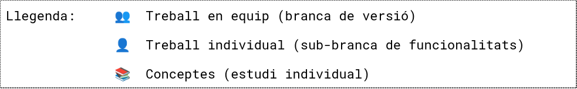
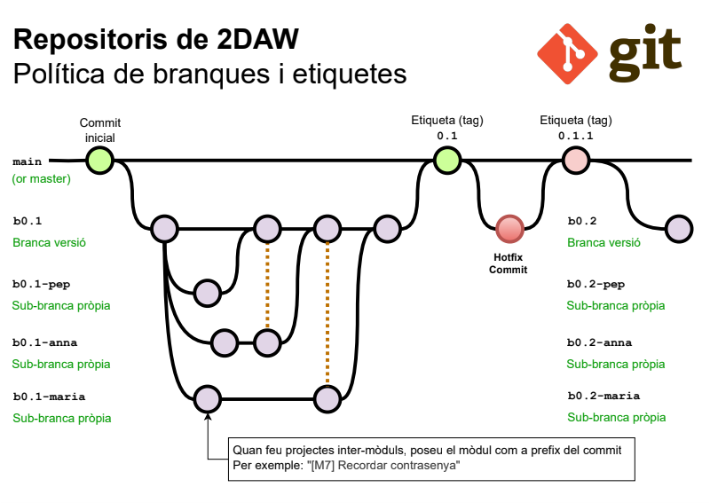

# Projecte 1 - Sprint 1
## Desenvolupament Web amb Flask i metodologia Scrum

**Mòdul:** CFGS 2n Curs - Desenvolupament d'Aplicacions Web (DAW) 
**Projecte:** Aplicació de compra i venda de segona mà (*Wannapop*) 

---

## Llegenda

---

## Objectiu General del Projecte

* **Construir la base funcional** d'una aplicació web de compra i venda de productes de segona mà.
* Treballar amb el framework **Flask**, el llenguatge **Python** i repositoris **Git**.
* Implementar una arquitectura web neta basada en el patró **MVC** (Model-Vista-Controlador).
* Desenvolupament dividit en **3 Sprints** progressius.

---

## Metodologia Scrum a l'Aula

* **Durada de l'Sprint 1:** 2 setmanes.
* **Treball en equip i individual:** Combinació de desenvolupament en grup i tasques personals.

[Veure calendari](https://docs.google.com/spreadsheets/d/1StpYoS0GBUJZkSlFvs7vaY3qGOjMbRKlzaiMDM6x6Lg/edit?usp=drive_link)

---

## Metodologia Scrum a l'Aula

### Rols del Projecte
* **Product Owner (Professorat):** Defineix què ha de fer l'aplicació i resol dubtes sobre la funcionalitat o el Product Backlog.
* **Scrum Master (Professorat):** Facilita la metodologia, ajuda a organitzar el treball i resol impediments de procés.
* **Equip de Desenvolupament (Alumnat):** Responsable d'organitzar-se, transformar les user stories en tasques i programar.

> **Regla ràpida:** «Què ha de fer l'aplicació?» \\(\rightarrow\\) **Product Owner** | «Com ens organitzem?» \\(\rightarrow\\) **Scrum Master**  .

---
## Product Backlog

[Veure Product Backlog](https://docs.google.com/spreadsheets/d/1DAYrk85ZWL_7I6I-ASEQnj9ZkS8dNS93Xji73LBmIXs/edit?usp=sharing)

---

## Sprint 1 Backlog (Funcionalitats)

En aquest primer Sprint desenvoluparem les següents funcionalitats clau:

### 👤 Gestió d'Usuaris
* **3.1** — Consultar usuaris
* **3.2** — Consultar el perfil d'un usuari

### 📦 Gestió de Productes
* **4.1** — Consultar la llista de productes
* **4.2** — Consultar el detall d'un producte 
* **4.3** — Publicar un producte nou 
* **4.4** — Editar un producte propi 
* **4.5** — Eliminar un producte propi 

*Nota: Les funcionalitats que no figuren en aquest llistat es treballaran en Sprints posteriors.*

---

## Repositori git

---

## Codis proporcionats 

### Codi d'exemple amb branques

[Codi d'exemple a Github](https://github.com/jmirinformatica/2daw-abp-p1-s1-example)

### Script de la BD (Sprint 1 - Versió 0.1)

[A fer servir quan us els demanin](https://docs.google.com/document/d/1W-4FS0cQaZfJoVWqIkg9yDKO7wlxzXq9pPJq4iyzLm0/edit?usp=sharing)

---
## Entorn i configuració

Parts 1, 2 de l'enunciat.

### Entorn i Configuració
* Creació de l'entorn virtual `.venv` i instal·lació de dependències enregistrades a `requirements.txt`.
* Ús de `.env` i `config.py` per gestionar claus i configuracions sensibles  .
* Configuració de logs en fitxer rotatori (`app.log` mitjançant `RotatingFileHandler`)  .

---
## Entorn i configuració i BD

Part 3 de l'enunciat.

### Base de Dades
* Ús del SGBD **SQLite** (`database.db`).
* El fitxer `.db` no es puja al repositori (s'afegeix a `.gitignore`); cal incloure l'script `.sql` i una BD inicial  .

---
## Arquitectura web 📚

**Part 4 de l'enunciat**. S'expliquen conceptes:

* CRUD
* Model Vista Controlador

---

## ORM, MVC i Formularis

Part 5 i 6 de l'enunciat

### ORM i Modularitat (MVC)
* Implementació de l'ORM **Flask-SQLAlchemy** amb els models `User` i `Product` .
* (*Re-factoring*) Organització mitjançant el patró **Application Factory** (`create_app`).
* Divisió de rutes en tres **Blueprints**: `routes_main`, `routes_products` i `routes_users`  .

---

## Formularis

Part 7 de l'enunciat

### Formularis i Validació
* Ús de **Flask-WTF / WTForms** per a operacions de creació, edició i eliminació (CRUD).
* Validació de camps obligatoris, formats i pujada d'imatges (`photo` i `avatar`, màxim 2 MB) al directori `uploads/`.

---

## Millores

* Exportació d'usuaris i productes
* Hashids

---
## Criteris d'Avaluació i Documentació

* **Rúbriques del Moodle** 
* **Control de versions:** Històric de commits i existència d'etiquetes de Git.
* **Documentació al README.md obligatòria:**
  * Instruccions per crear i configurar l'entorn virtual.
  * Com configurar el fitxer `.env` i inicialitzar la BD.
  * Usuaris de prova i com iniciar l'aplicació.