# Criptosistemes  
## Xifrat de dades i eines de xifrat d'extrem a extrem 

---

# 1. Criptosistemes

Un criptosistema és el conjunt de tècniques que permeten protegir la informació perquè només la pugui llegir qui està autoritzat.

---

# 2. Què resolen? 

## Repàs dels pilars bàsics de la seguretat informàtica

- Protegir confidencialitat
- Garantir integritat
- Assegurar autenticació
- Evitar el repudi

---

# 3. Criptosistemes antics. Cèsar

Posa com a exemple el del Cèsar.

Slides 7, 8, 9 de criptografia.pdf

Enllaça-ho amb la màquina Enigma.

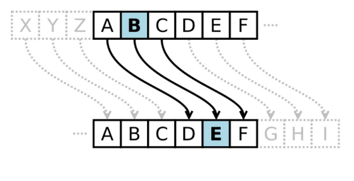

---

# 3.1. Criptosistemes antics. Plantilles Cèsar

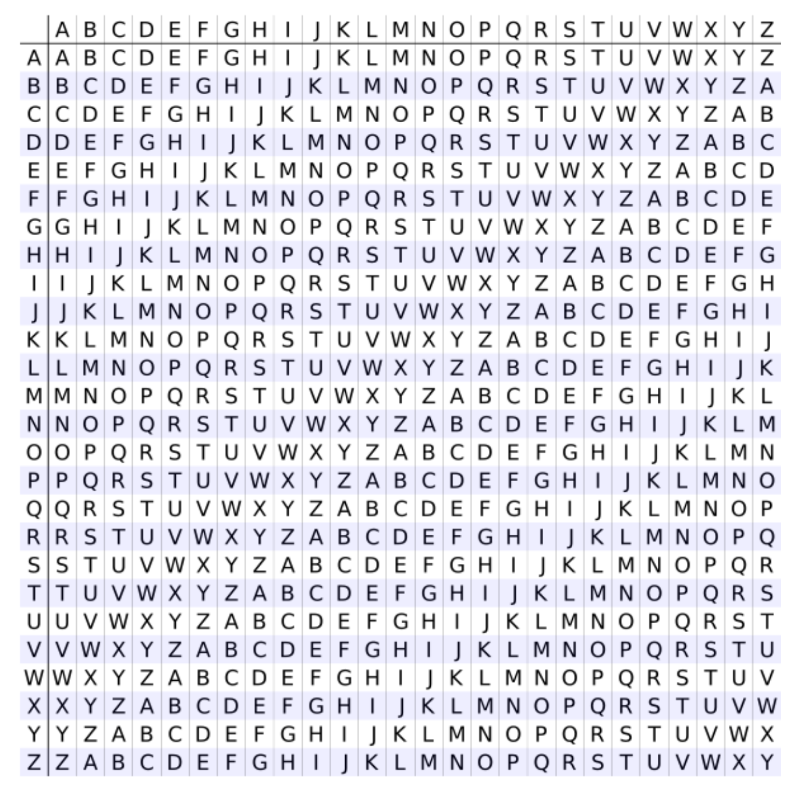

---

# 3.2. Criptosistemes antics. Exemple Cèsar

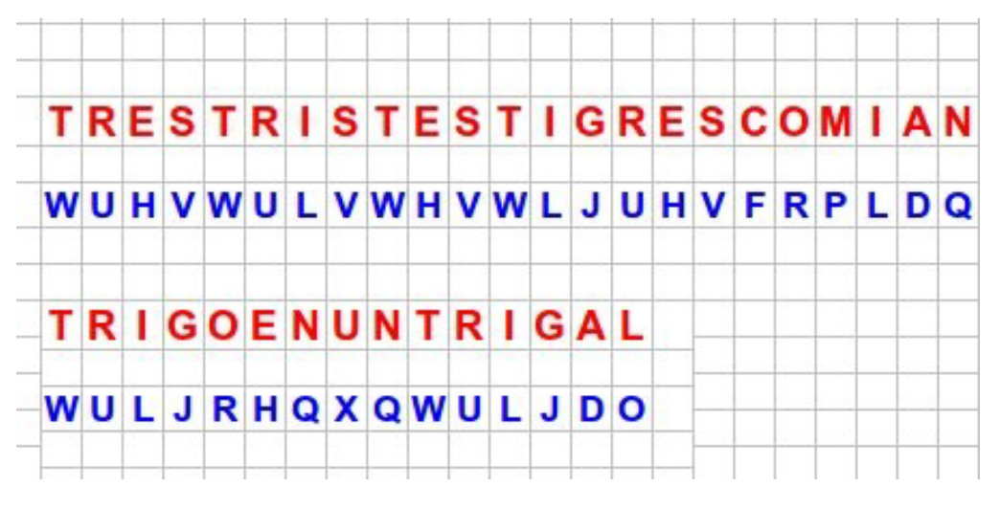

---

# 4. Eina Enigma 

- Semblant al del Cèsar. Es fa servir una màquina que va creuant l'alfabet a cada pulsació de tecla.

- És com si a cada tecla que escrius es canviés la plantilla de les que es fan servir al Cèsar. **Se'n diu polialfabètic**: Cada vegada que prems una tecla els rotors de la màquina giren i canvia l’alfabet de substitució

    - **Resultat**: La mateixa lletra no es xifra mai igual dues vegades seguides!!

---

# 5. Criptosistemes moderns. Xifrat simètric

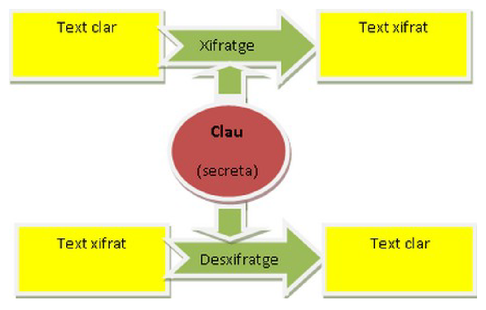 

Quins problemes té el xifrat simètric?

---

# 6. Criptosistemes moderns. Xifrat simètric. Algoritmes

- *AES* = Advanced Encryption Standard
    - Longitud de claus: 128, 192 o 256 bits

- *DES* = Data Encryption Standard (obsolet)
    - Longitud de clau: 56 bits (actualment insegur)
    - Històricament molt utilitzat fins als anys 90

- N'hi han molts meś: *Blowfish, Serpent, Twofish, Camellia, CAST-128, IDEA, RC2,
RC5, SEED, Skipjack, TEA, XTEA*

---

# 7. Criptosistemes moderns. Xifrat asimètric. Algoritmes

- *RSA*: La seguretat ve de la dificultat de factoritzar nombres grans.
- *Diffie-Hellman (DH) i DSA (Digital Signature Algorithm)*. Logaritme discret.
- *ECC*. Es basa en els avenços dels estudis de les corbes el·líptiques

---

# 8. Criptosistemes moderns. Xifrat asimètric. RSA

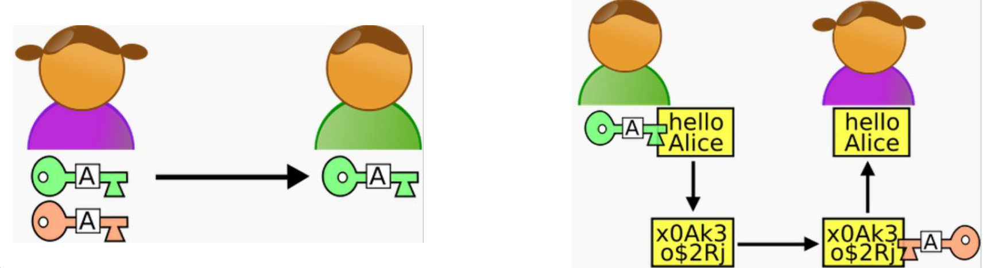

---

# 8.2 Criptosistemes moderns. Xifrat asimètric. RSA

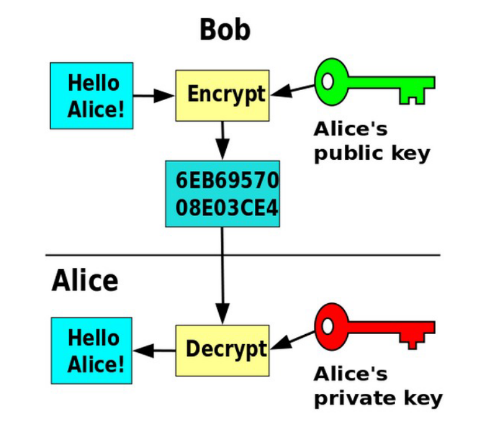

---

# 8.3 Criptosistemes moderns. Xifrat asimètric. RSA

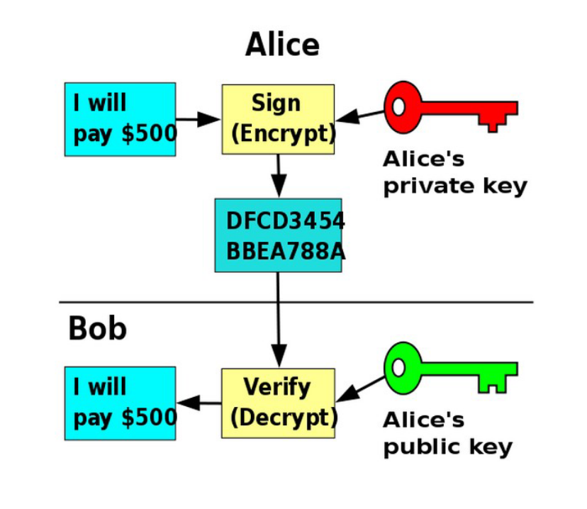

---

# 9. Base matemàtica. Petit Teorema de Fermat

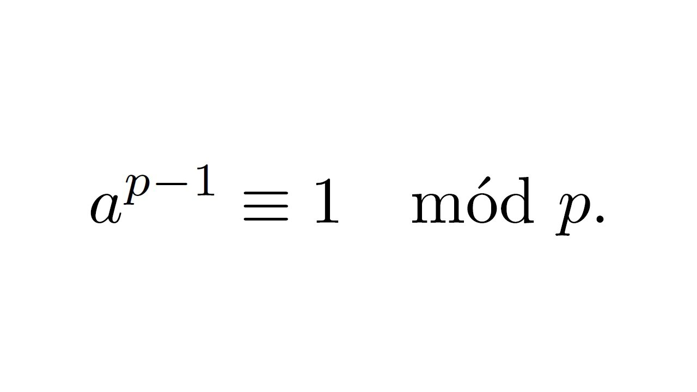

## SIMPLIFICACIÓ:
Si $n$ (la base del cos d'enters) és $p·q$, on $p$ i $q$ són primers, aleshores existeixen
dos nombres $e$ i $d$ tal que $c = m^e$ i $m = c^d a$.

**La gràcia de RSA**: és molt fàcil el calcul de potència `mod(n)` i molt difícil factoritzar un nombre que sigui potència de dos primers molt grans. Fan falta, per tant, dos nombres primers molt grans --> Calen claus grans.

---

# 9.2 Base matemàtica. Petit Teorema de Fermat

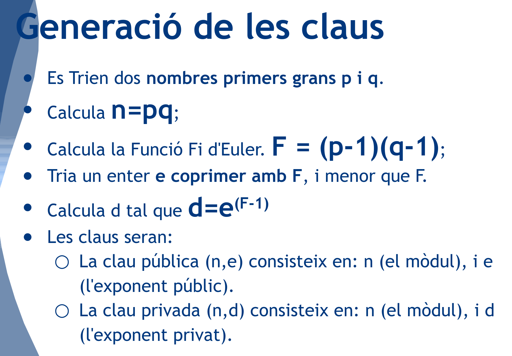

---

# 10. Base matemàtica. Corves el·líptiques

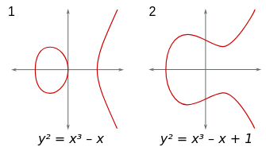

Es van començar a estudiar des de la perspectiva de la seguretat informàtica a partir de l'ús que se'n va fer d'elles per demostrar el gran teorema de Fermat.

La gràcies del xifrat basat en corves el·líptiques: 

[Criptosistemes amb corbes el·líptiques](https://criptored.es/crypt4you/temas/ECC/leccion2/leccion2.html#apartado22)

---

# 10.2 Criptosistemes moderns. Corves el·líptiques

## Exemple concret: Intercanvi de claus

$P$: Punt públic d'una corva el·líptica.
$k$: Nombre privat.
$Q$: clau pública

**1. Càlcul de claus públiques.**

Alice té $k_a$ (privada) i $Qₐ = k_a·P$
Bob té $k_b$ (privada) i $Q_b = k_b·P$

**2. Càlcul de compartida entre les dues persones ($S$)**

Alice calcula: $S=k_a⋅Q_b$
Bob calcula: $S=k_b⋅Q_a$

---

# 10.3 Criptosistemes moderns. Corves el·líptiques

## Exemple concret: Intercanvi de claus

- Tots dos obtenen el mateix punt $S$ (Clau compartida)
- Amb $S$ es fa servir un algoritme de xifrat simètric *(AES)*.
- Un atacant només veu $P$, $Q_a$ i $Q_b$, però:
    - No coneix $k_a$ ni $k_b$
    - No pot calcular $S$ 
    
---

# 11. Criptosistemes moderns. Funcions hash

- Fàcil de calcular en un sentit
- Difícil de revertir (no pots obtenir l’entrada original)
- Qualsevol canvi mínim a l’entrada canvia radicalment el hash
- Sortida de mida fixa, independent de la mida de l’entrada
- Analogia: És com una empremta digital del fitxer o missatge.
- Hashos no xifren informació, només la “resumixen” de manera segura.

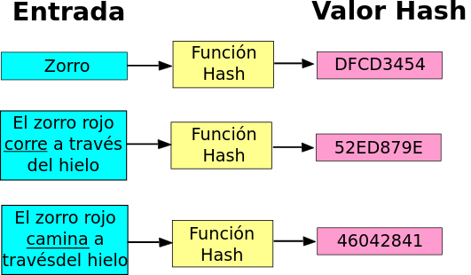

---

# 11.1 Criptosistemes moderns. Funcions hash

---

# 11.2 Criptosistemes moderns. Funcions hash. Algoritmes

*MD5*: 128 bits; Antiga i insegura.

*SHA-1*: 160 bits; També insegura. Feta servir abans de 2010.

*SHA-256*: 256 bits. TLS, certificats.

*SHA-3*: 224, 256, 384, 512 bits. Molt ràpida.

---

# 11.3 Criptosistemes moderns. Funcions hash. Usos

- Emmagatzematge de contrasenyes (hash amb salts)
- Comprovació d’integritat de fitxers (SHA-256 de l’ISO d’Ubuntu)
- Signatures digitals (hash → RSA/ECC signa el resum)
- Blockchain / criptomonedes (Bitcoin → SHA-256)

---

# 11.3 Signatura digital. Klaus de xifrat i funcions hash

- Es fa servir una funció hash per obtenir un “resum” del missatge.
- L'emissor xifra el resum amb la seva clau privada.
- Qualsevol que tingui la clau pública del emissor pot desxifrar el resum i comprovar si coincideix amb el resum del missatge que ha rebut.

---

# 12. Aplicació dels criptosistemes moderns en la comunicació actual

- *SSL/TLS* (*HTTPS* la fa servir; *VPN*, **SMPT**, etc.)

- *SSH* (accés remot a servidors)

- *MTProto* (*Telegram*)

- *E2EE*: Xifrat d'extrem a extrem amb protocols com *PGP* i eines com *GPG*