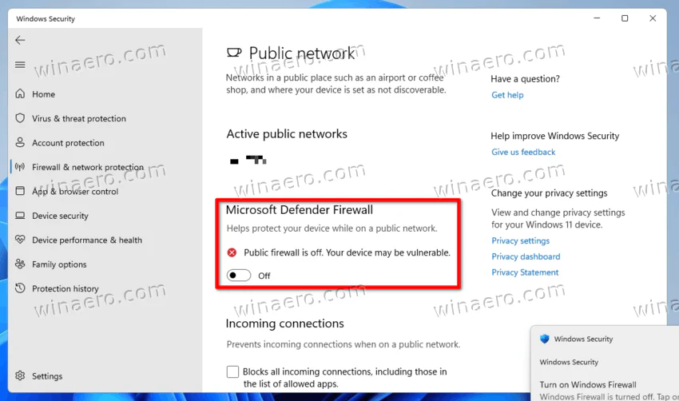
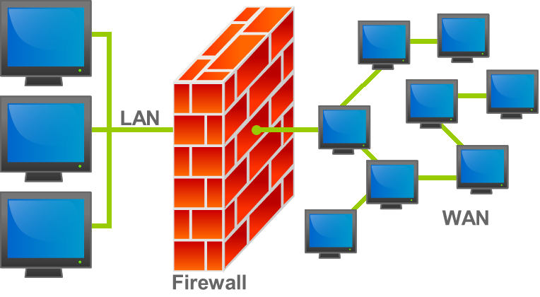
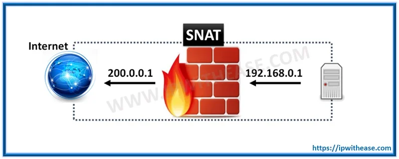
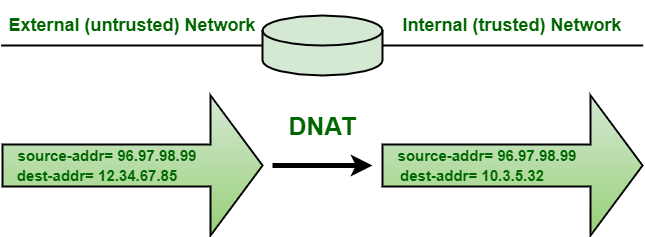
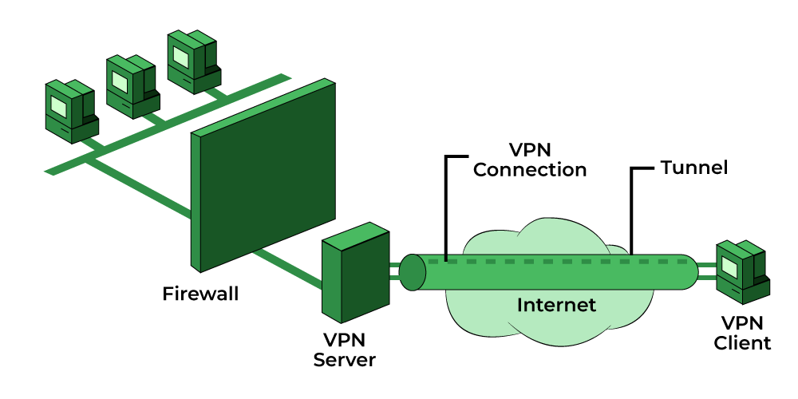
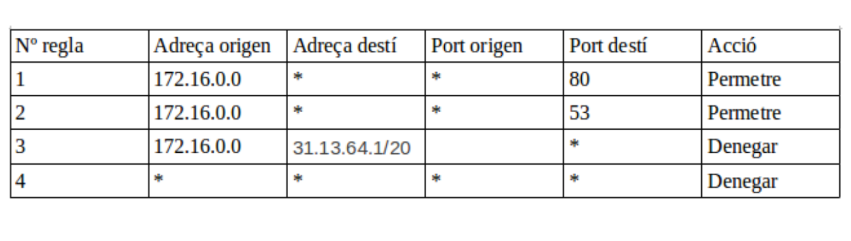
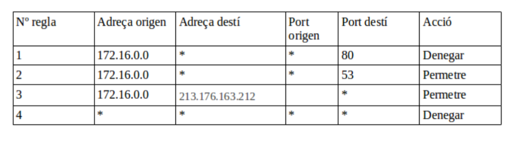

# :one: Tallafocs

**Definició:**

- Un tallafoc (firewall) és un sistema dissenyat per controlar l’accés a les xarxes i els sistemes. 

- Aquest dispositiu pot funcionar com a element de xarxa i gestionar els permisos d’accés entre xarxes diferents i els nivells de confiança. 

- O també funcionar com a aplicació en els amfitrions (hosts) per protegir tant les connexions entrants com sortints del sistema, concretament de la resta de la xarxa.

---

# :two: Classificació 

## Tallafocs en equips i servidors

---

# :two: Classificació

## Tallafocs de xarxa

---

# :two: Classificació

Una altra classificació dels tallafocs

## **Tallafocs sense estat (stateless)**
les dades que fan servir són, estrictament, les que conté el paquet. Normalment, les dades que s’utilitzen són l’origen, la destinació, el protocol i, si el protocol de transport ho suporta, el port d’origen i el de destinació.
## **Tallafocs amb estat (statefull)**
permet identificar si un determinat paquet inicia una connexió nova, si és d’una connexió existent o si és un paquet invàlid.

---

# :two: Classificació

Proxy

- També filtren el tràfic
- Inspeccionen les dades del protocol d'aplicació 
- Implica un cost més gran de procesament

---

# :three: Quina política aplicar en un tallafocs

- **Política restrictiva**: denega tot el trànsit, tret del que se li indica (equival a una llista blanca).

- **Política permissiva**: permet tot el trànsit, tret del que se li indica (equival a una llista negra).

---

# :four: Tallafocs. Funcions

## Filtratge de paquets

- **PERMIT**
- **DROP**
- **REJECT**

---

# :four: Tallafocs. Funcions

## **NAT**
    - **SNAT** (modificar l’adreça origen)
    - **DNAT** (modificar l’adreça destinació).

## **Intrussion detection system (IDS)**

## **Intrussion Prevention system (IPS)**

## **VPN**

---

# :four: Tallafocs. SNAT

---

# :four: Tallafocs. DNAT

---

# :four: Tallafocs. IDS/IPS

- La sigla *IDS* correspon a **intrusion detection-system**. Es tracta d’un sistema que detecta intrusions o intents d’intrusió i en notifica, però no els evita. 

- La sigla *IPS* correspon a **intrusion prevention-system**. El sistema, quan detecta un intent d’intrusió, es pot configurar per bloquejar-lo o bé pot afegir el sistema originant del paquet en una llista negra per evitar l’atac que ha detectat i intents futurs.

- L'IDS/IPS: basa la detecció d’intrusions en l’anàlisi dels paquets que circulen per la xarxa. Inspecciona els paquets per cercar-hi signatures.

---

# :four: VPN

Alguns fabricants que ofereixen firewall amb VPN integrada:

- **Fortinet** (FortiGate)
- **Cisco** (ASA, Firepower)
- **Sophos** (XG Firewall)
- **Ubiquiti** (UniFi)

---

# :four: VPN

---

# :five: Exemples

---

# Veure firewall de Windows

---

https://gist.github.com/rxaviers/7360908