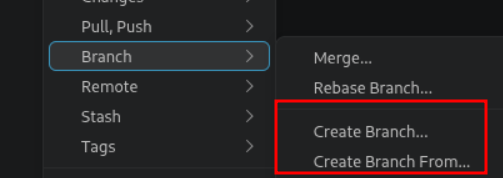
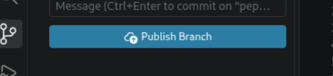
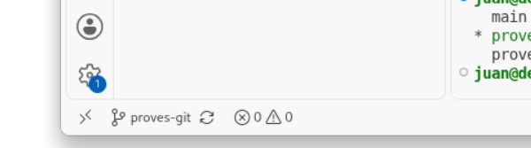
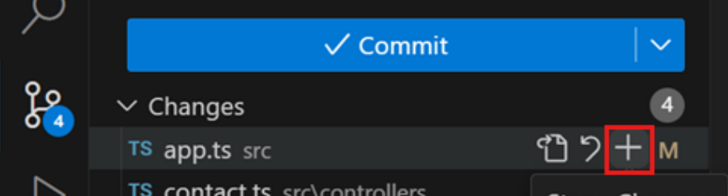
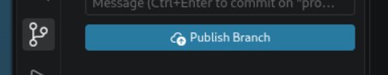
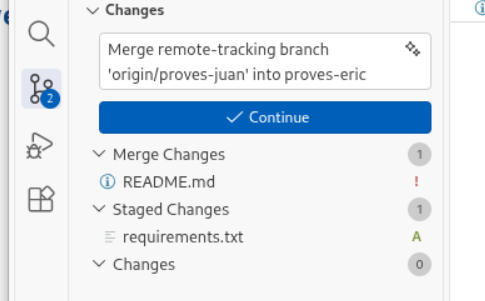
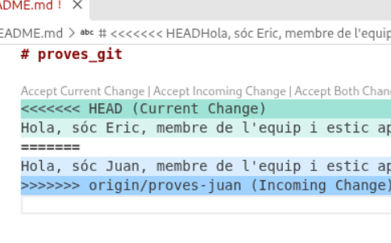
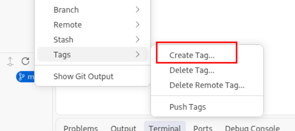
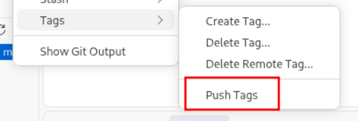
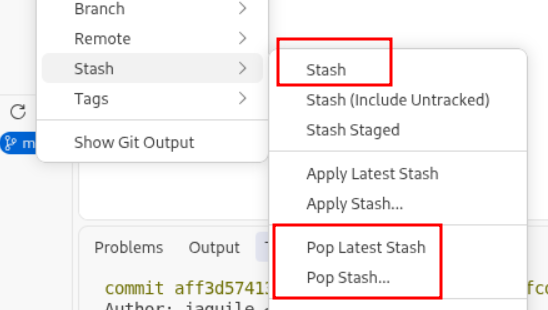

# Taller de Git 
## Receptes útils per sortir del pas els primers dies

**Mòdul:** CFGS 2n Curs - Desenvolupament d'Aplicacions Web (DAW) 
**Projecte:** Aplicació de compra i venda de segona mà (*Wannapop*) 

---

# Índex

0. Zones o àrees de GIT
1. Repositori
2. Clonar un repositori
3. Repositori local vs repositori remot
4. Branca
5. Branca en local vs branca en remot
6. Etiquetes
7. Algunes accions que podem fer amb GIT
8. Receptes i exercicis

---

# :zero: Conceptes. Zones o àrees de Git

* Directori de treball (*Working Directory*)
* Àrea de preparació (*Staging Area o Index*)
* Repositori Git (*Git Directory o repository*)
* Repositori Git remot (normalment s'identifica com a `origin`)
    * Pot haver més d'un repositori remot

---

# :one: Conceptes. Repositori

Un repositori a Git és, en essència, la carpeta del teu projecte on Git fa el seguiment de tots els canvis.

Un repositori conté una carpeta oculta anomenada .git. Aquesta carpeta oculta: 
* Té l'historial complet de modificacions 
* qui ha fet cada canvi, quan es van fer
* les diferents branques i tots els commits del projecte des del primer dia.

---

# :two: Conceptes. Clonació d'un repositori remot

```bash
git clone <URI del repositori remot>
```

---

# :three: Conceptes. Repo local vs repo remot

Normalment es treballa amb un repo remot i amb una sèrie de repos locals (un per cada membre de l'equip). A més, aquests repos poden tenir també les seves respectives branques. **A Git, el repositori remote (remote) se li acostuma a anomenar `origin`**. A la branca principal, `main`.

**Alguns Usos del punter `origin`?** 
> En local, a part del nostre repositori tindrem també una mena de branca que no forma part del nostre repositori i que conté informació del repositori remot. Això pot ser útil per mirar les diferències del repositori remot amb el nostre abans d'integrar res, per exemple. 

---

# :four: Conceptes. Branca

* És una ramificació del teu repositori. De tal manera que pots tenir codis separats per branca.
* Una branca sempre apunta a l'últim *commit* fet en dins d'ella.

```bash
# Hi han altres comandes per fer i canviar de branca

git checkout -b <nom de branca>   # et crea la branca i et canvia a ella

git chekout <nom de branca>       # Només et canvia a la branca
```

---

# :five: Conceptes. Branca en local vs branca en remot

* En local, quan crees una branca (que no sigui la principal) sempre apunta o parteix d'una altra branca.

* En remot no. En remot cada branca és independent de l'altre. 

---

# :six: Conceptes. Etiquetes (tags)

[text extret de la documentació de git](https://git-scm.com/book/es/v2/Fundamentos-de-Git-Etiquetado) ...

> **Etiquetado**
> Como muchos VCS, Git tiene la posibilidad de etiquetar puntos específicos del historial como importantes. Esta funcionalidad se usa típicamente para marcar versiones de lanzamiento (v1.0, por ejemplo). 

---

# :seven: Conceptes. Accions bàsiques a Git

| Comanda / concepte               | Acciò                                                                            |
|----------------------------------|----------------------------------------------------------------------------------|
| `git add`                        | Afegir un o més arxius a l'àrea de preparació.                                  |
| `git commit`                     | **Confirmació de canvis** (*commit*): Git emmagatzema una instantània o foto de tot el teu treball i afegeix metadades.                                                                                                             |
| `git merge`                       | Integració de branques.                                                  |
| `git push`                        | Pujada de fitxers a la branca remota corresponent.                          |
| `git pull`                       | Baixada de fitxers i integració a la branca local (`fetch` + `merge`).   |
| `git fetch`                      | Baixa canvis del remot **sense fusionar**. Útil per veure què ha canviat o per fer integracions d'altres branques.   |

---


# :eight: Receptes i exercicis

### A partir d'aquí, la idea és donar receptes típiques que us poden fer falta a l'enunciat de l'sprint i fer a continuació exercicis relacionats a les receptes proposades. 

### La idea és fer receptes tant per terminal com per la utilitat de gestió de Git que disposa VSCode.

---

# Recepta 1. Crear branca i pujar-la a remot

## VS Code

`Create branch from ...` > Seleccionem branca d'on volem penjar la nova branca > donem nom a la branca > *Publish branch*

1.  2.  3. 

---

# Recepta 1. Crear branca i pujar-la a remot

## Comandes

```bash
git checkout <branca pare>          # 1. anem a branca d'on ha d'apuntar

git checkout -b <branca nova>       # 2. Creem branca nova i ens canviem

git push -u origin <branca nova>    # 3. La primera vegada
```

---

# Recepta 2. Baixar-se a repositori local nova branca

## A VScode

1. Fem un `fetch`: ens baixem la branca `origin/<nova branca>`. No està encara integrada en el nostre repositori.
2. Fem click al nom de la branca on som actualment 

3. i a dalt surt llistat de branques. Escollim `origin/<nova branca>`


---

# Recepta 2. (Comandes) Baixar-se a repositori local nova branca

## Per comandes 

```bash
git fetch origin                    # Baixem nova branca
git checkout <nom de la branca>     # La integrem en el nostr repositori
```

---
# Exercici 1 

## 1.1. Un membre de l'equip ha de crear en el seu repositori local una branca que es digui `proves-troncal` i apunti a b.0.1

## 1.2. En acabat, que pugi la branca al repositori remot.

## 1.3. Després, que l'altre membre es baixi els canvis de la nova branca

---

# Recepta 3. Com fer un commit dels vostres canvis i pujar-los al repositori remot

## A VSCode

1. Pujar el fitxer a l'*staged area*



---

# Recepta 3. Fer un commit dels vostres canvis i pujar-los al repositori remot (continuació)

## A VSCode

2. Pujar els canvis al repositori local amb un commit.


3. Publicar els canvis de la branca al repositori remot



---

# Recepta 3. (Comandes) Fer un commit dels vostres canvis i pujar-los al repositori remot 

## Per comandes

```bash
git add <fitxer que volem pujar>    # pugem a staged area
git commit -m "missatge ..." <fitxer que volem pujar>
                                    # pugem a repositori local
git push                            # pugem a repositori remot
```

---

# Exercici 2 

### 2.1. Ara, que cada membre de l'equip es generi una nova branca en el seu repositori local apuntant a branca `*proves-troncal*` que es digui `proves-<el seu nom>`. Per exemple: `*proves-juan*`

### 2.2. En les vostres respectives branques, afegiu un fitxer `proves-readme.md` amb el següent contingut:

```bash
# Proves-readme

Hola, sóc <afegiu el vostre nom> i estic aportant una línea al proves-readme.md
```

### 2.3. Finalment, pugeu els canvis al repositori remot

---

# Exercici 3

## 3.1. Un únic membre de l'equip ha de crear a la seva branca el fitxer `proves-requirements.txt` amb el següent contingut:

```bash
Fitxer de dependències de la nostra aplicació
```

## 3.2. L'altre ha de crear `proves-config.py` a la seva branca amb:

```python
# Fitxer de configuració de la nostra aplicació
```

## 3.3. 👥 Modifiqueu el `proves-readme.md` (commit i push)

---
<!-- _class: important -->
# Recepta 4. Integració entre branques

## Què passa en situacions com la nostra?

### Situació

> Tenim un codi a branca troncal, dues branques que pengen del troncal i que treballen en paral·lel i en un moment donat s'integra tot a la branca troncal per continuar després amb la nostra branca individual i amb tot el codi actualitzat? 

---
<!-- _class: important -->

# Recepta 4. Integració entre branques

## Regla: Primer, tot cap amunt i després, cap avall

### Situació. Suposem:

* **Branca troncal**: `proves-troncal`
* **Branca membre 1**: `proves-juan`
* **Branca membre 2**: `proves-eric`

---

# Recepta 4. Integració entre branques

### Pas 0. Previ a la integració

```bash
0: DESENVOLUPAMENT INDIVIDUAL
===================================
branca-juan:  [ Canvis Juan ] ──┐
                                │  (Tots dos treballen en paral·lel
tron (pare):  [ Codi Base  ]    │   sense saber què fa l'altre)
                                │
branca-eric:  [ Canvis Eric ] ──┘
```

---
<!-- _class: important -->
# Recepta 4. Integració entre branques

### Pas 1. Tot el codi cap amunt

```bash
1: LA PUJADA (INTEGRACIÓ CAP AMUNT)
===================================
branca-juan:  ───────────────────┐ (1.1)
                                 ▼
tron (pare):  [ Codi Base ] ──> [ +Juan ] ──> [ +Juan +Eric (CONFLICTES!) ]
                                                ▲
branca-eric:  ──────────────────────────────────┘ (1.2: Eric resol conflicts)
```

## EN AQUEST PUNT POSEM ELS TAGS A LA BRANCA TRONCAL

---

<!-- _class: important -->
# Recepta 4. Integració entre branques

## Membre 1

### Pas 1. Tot el codi cap amunt (membre 1)

1. `proves-juan` puja canvis a la seva branca (local i remot)
2. Juan es canvia a branca troncal (`proves-troncal`)
3. Juan fa un pull de branca troncal (per seguretat)
4. Juan fa merge per integrar canvis de la seva branca a la troncal
5. Juan puja canvis de la branca troncal a repositori remot

---

<!-- _class: important -->
# Recepta 4. Integració entre branques

## Membre 2

### Pas 1. Tot el codi cap amunt (membre 2)

1. `proves-eric` puja canvis a la seva branca (local i remot)
2. Èric es canvia a branca troncal (`proves-troncal`)
3. Èric fa un pull de branca troncal (baixa+integra canvis)
4. Èric fa merge per integrar canvis de la seva branca a la troncal. Resolc conflictes. Els puja en local (commit)
5. Èric genera els tags que calguin.
6. Èric puja canvis de la branca troncal a repositori remot

---

# Recepta 4. Integració entre branques

## Conflictes (VS Code)

 

Resolem conflictes: 1. treiem marques i arreglem fitxers. 2. Fem commit dels canvis

---

# Recepta 4. Integració entre branques

### Pas 2. Tot el codi cap a vall

```bash
2: LA BAIXADA (SINCRO CAP A VALL)
===================================
tron (pare):  [ CODI FINAL ACTUALITZAT ]
                │                        │
                │ (2.1: Pull i merge)    │ (2.1: Pull i merge)
                ▼                        ▼
branca-juan:  [ Codi Final ]         [ Codi Final ] : branca-eric

                ▲                        ▲
                └─────── (2.2: push) ────┘ (Push de seguretat de
                                        les branques individuals)
```

---
<!-- _class: important -->
# Recepta 4. Integració entre branques

## Membre 1 i membre 2 a la vegada

### Pas 2. Tot el codi cap a vall (membre 1 i membre 2)

#### Resum

1. Canviem a branca troncal. Fem pull (actualitzem canvis)
2. Canviem a la nostra branca.
3. Integrem el codi nou que hi ha a branca troncal a la nostra branca individual fent `git merge <branca troncal>`
4. Actualitzem les nostres branques individuals en remot (push)

---

<!-- _class: important -->
# Recepta 4. Integració entre b0.1 i main

## AL FINALITZAR CADA SPRINT CREAREM UN TAG AL MAIN PER ETIQUETAR LA VERSIÓ  DE LA NOSTRA APLICACIÓ
---

# Exercici 4 

## 4.1. Que un membre de l'equip faci integració cap a munt
## 4.2. Després, Que l'altre membre de l'equip faci la seva respectiva integració cap a munt. Després, que afegeixi el tag `exercici.4` a la branca troncal (`proves-troncal`) amb el missatge *Resolució de l'exercici 4*
## 4.3. Feu cadascú en paral·lel la integració cap a vall

---

# Recepta 5. Com fer tags 

## VS Code

:one: Generem tag amb missatge > :two: Pugem tags

 

---

# Recepta 5. Com fer tags 

## Comandes

Canviem a branca troncal i (Exemple de l'enunciat Sprint 1):

```bash
git tag 0.1.1-config -m "Versió 0.1.1 amb dependències, config i logging"
git push origin b0.1 --tags
```

---


# Recepta 6. No ens deixa canviar de branca

* No podem canviar de branca perquè tenim canvis en local no *commitejats*.

    * **Opció 1**: fem commit i ja podrem
    * **Opció 2**: 
        1. fem `git stash` i ja podem canviar
        2. Quan volguem tornar a la nostra branca individual: canviem com normalment i després recuperem la feina que teníem amb `git stash pop`

> A VSCode ho pdeu fer des de: ... > stash

---

# Recepta 6. Fer git stash i git stash pop a VS Code



---

# Referències

* Molt útil també el [cheat-sheet de git](https://git-scm.com/cheat-sheet).
* [Source Control in VS Code](https://code.visualstudio.com/docs/sourcecontrol/overview)