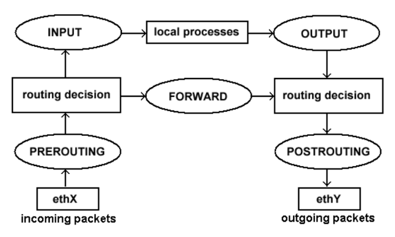

# :one: Iptables. Taula nat

```bash
iptables -t nat -A <cadena> <opcions de filtrat> -j <acció>
```

**nat**: defineix com es modifiquen i es redirigeixen els paquets que entren per la interfície de xarxa (PREROUTING) o estan a punt de sortir per la interfície de xarxa (POSTROUTING).

## Cadenes

### REGLES PREROUTING

### REGLES POSTROUTING

---

# :one: Iptables. Taula nat

## Ordre en l'anàlisi de regles sobre un paquet



---

# :five: Taula NAT

```bash
iptables -t nat -A <cadena> <opcions de filtrat> -j <acció>
```
## ACCIONS

Accions que podem fer sobre un paquet

- Es canvia alguna adreça IP i/o algun port d'origen - **SNAT**
- Es canvia l'adreça IP d'origen amb la del router (L'enmascara) - **MASQUERADE**
- Es canvia alguna adreça IP i/o algun port de destí - **DNAT**

---

# :five: Taula NAT

```bash
iptables -t nat -A <cadena> <opcions de filtrat> -j <acció>
```
## MASQUERADE VS SNAT

- Amb l'acció MASQUERADE, el sistema substitueix dinàmicament l'adreça IP de font dels paquets sortints amb la pròpia adreça IP de l'interfície de sortida. Això és útil quan no tens una adreça IP fixa per a l'interfície de sortida.

- Amb l'acció SNAT, pots especificar explícitament una adreça IP que vols utilitzar per a la traducció de l'adreça IP d'origen dels paquets sortints. 

---

# :five: Taula NAT

```bash
iptables -t nat -A <cadena> <opcions de filtrat> -j <acció>
```
## OPCIONS

Algunes opcions útils

- `-s (IP origen) / -d (IP destinació)`: especificar IP d’origen/destí. 
- `-i (interfície d’entrada) / -o (interfície de sortida)`.
- `-p (protocol)`: TCP, UDP, ICMP, ALL, etc.
- `--sport / --dport`: port d’origen/destí.

---

# :five: Taula NAT

```bash
iptables -t nat -A <cadena> <opcions de filtrat> -j <acció>
```
## OPCIONS

Algunes opcions útils

- `--to-source (Adreça Ip ó Adreça IP:port)`: Canviem la IP d'origen per aquesta IP i aquest port, si l'especifiquem.
- `--to-destination (Adreça Ip ó Adreça IP:port)`: Canviem la IP de destí i el port per aquesta IP i port.

---

# :five: Taula NAT

```bash
iptables -t nat -A <cadena> <opcions de filtrat> -j <acció>
```
## EXEMPLES

```bash
iptables –t nat –A POSTROUTING –o enps03 –j MASQUERADE

iptables -t nat -A POSTROUTING -s 192.168.1.0/24 -o enps03 -j SNAT --to-source 203.0.113.10

iptables -t nat -A PREROUTING -i enps03 -p tcp --dport 80 -j DNAT --to-destination 192.168.1.10:8080
```

---

https://gist.github.com/rxaviers/7360908