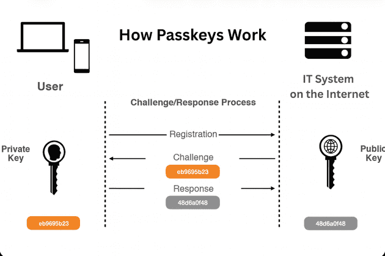

# Passkeys
## Alternativa a les contrasenyes

---

# Índex

0. Zones o àrees de GIT
1. Repositori
2. Clonar un repositori
3. Repositori local vs repositori remot
4. Branca
5. Branca en local vs branca en remot
6. Etiquetes
7. Algunes accions que podem fer amb GIT
8. Receptes i exercicis

---
# :zero: Com funciona el passkeys

---

# :one: Components

| Component            |            |
|----------------------------------|----------------------------------------------------------------------------------|
| **La clau pública**                        | El navegador l'envía automàticament al servidor web a l'enregistrar-te.                                  |
| **La clau privada**                     | S'emmagatzema de forma segura en el xip de seguretat del teu mòbil o en el teu gestor de contrasenyes(Bitwarden).                                                                                                             |
| El desbloqueig                       | Per fer ús de la clau privada necessites accedir per biometria o amb un PIN de seguretat.                  |
| L'aplicació (el servidor)                        | T'envia un desafiament que el teu dispositiu signa amb la clau privada |

---
<!-- _class: important -->

## És una passkey per web. La clau privada queda associada només a aquella web

## Si t'intenten fer Phishing per a que facis ús de la passkey, no funcionarà

---

# :three: FIDO - Fast Identity Online Alliance

- Associació industrial internacional
- Objectiu de FIDO: Eliminar el sistema de contrasenyes a internet
    - Crea estàndars tècnics i protocols 
- Quines entitats hi formen part: Google, Apple, Microsoft, Amzon, ... 

---

# Referències

* [Passkeys implementation](https://supertokens.com/blog/passkey-examples).
* [Pàgina de passkeys](https://www.passkeys.io/)