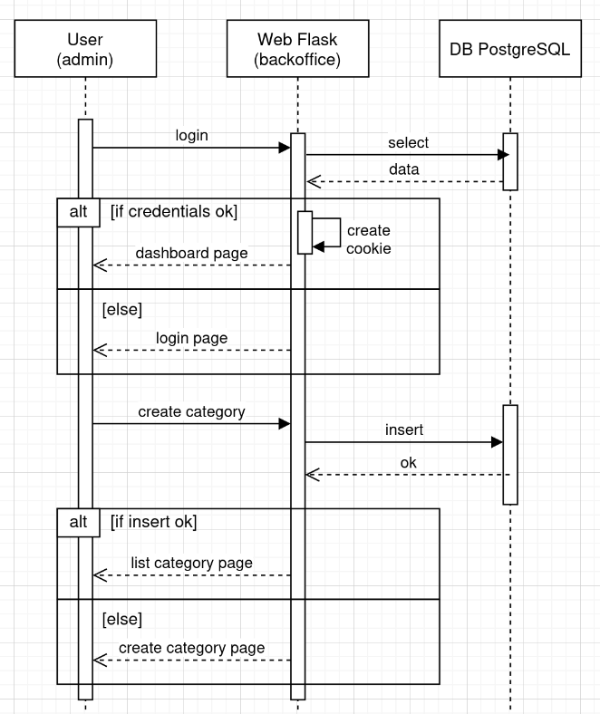

# UML
## Diagrama de seqüències

---

# :one: UML. Definició

## UML - Unified Modeling Language

El **UML** és un llenguatge estàndard de modelatge visual utilitzat en enginyeria de programari per descriure, dissenyar i documentar sistemes. No és un llenguatge de programació, sinó una manera de representar gràficament com està estructurat i com es comporta un sistema.

---

# :two: UML. Tipus de diagrames

## 1. Diagrames estructurals (com està fet el sistema):

- Diagrama de classes
- Diagrama de components
- Diagrama de desplegament
- Diagrama de paquets

---

# :two: UML. Tipus de diagrames

## 2. Diagrames de comportament (què fa el sistema):

- Diagrama de casos d’ús
- Diagrama de seqüència
- Diagrama d’activitats
- Diagrama d’estats

---

# :three: Diagrama de casos d'ús

Descriu o llista quines tasques o accions pot fer un actor extern sobre el sistema.

---

# :three: Diagrama de casos d'ús

## Elements

- **Actors**: simbolitzat amb ninots
- **Casos d'usos**: Òval amb el nom del cas d’ús a dins. El nom ha de ser un infinitiu amb un complement. Exemple: ***Registrar nou client***
- **Relacions** entre actors i casos d'ús. Simbolitzats amb fletxes, 

---

# :four: UML. Diagrama de seqüències

## Definició

Visualitza mitjançant un diagrama les interaccions entre les diferents entitats d’un sistema al llarg del temps o entre aquestes i els acords externs. Poden servir per detallar les diferents interaccions que es produeixen en un cas d’ús d’un sistema.

---

# :four: Diagrama de seqüències

## Elements

- **Participants (actors o objectes)** : Són les entitats que intervenen en la interacció. 

    - **Actors externs**: No formen part del sistema. Poden representar-se amb un ninot.

    - **Entitat** del sistema: Entitat que forma part del sistema i que interactua amb la resta d’entitats. Es simbolitza mitjançant un rectangle amb el nom de l’entitat / objecte

---

# :four: Diagrama de seqüències

## Elements

### Exemples de representacions de participants

```bash
Actor        Sistema
  o             |
 /|\            |
 / \            |

  | login()     |
  |------------>|
```

```bash
Usuari    Sistema    BaseDeDades
  |           |            |
```

---

# :four: Diagrama de seqüències

## Elements

- **Línea de vida**: Línea vertical que es dibuixa just a sota de cada participant i simbolitza el temps de vida de l’objecte o entitat dintre del flux o de la funcionalitat.

---

# :four: Diagrama de seqüències

## Elements

- **Activació de l’objecte**: Simbolitza quan l’objecte està procesant alguna alguna acció o operació, funció, etc. Es representa amb un rectangle vertical sobre la línia de vida.
- **Missatges entre entitats**: Es simbolitzen amb fletxes. Les fletxes discontínues són les respostes.
- **Altres**: Alternatives (if/else); optionals (if); bucles


---

# :four: Exemple de diagrama de seqüències



---

# :five: Passos per construir un diagrama de seqüències

## Pas 1. Identifiquem els participants
## Pas 2. Definim l'esdeveniment inicial
## Pas 3. Afegim crides / missatges
## Pas 4. Afegim condicions (if, if/else, bucles)

---
