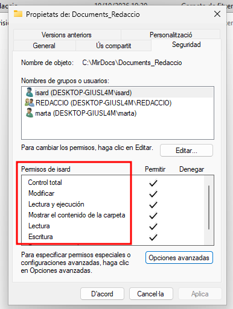
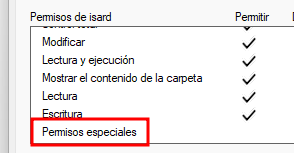
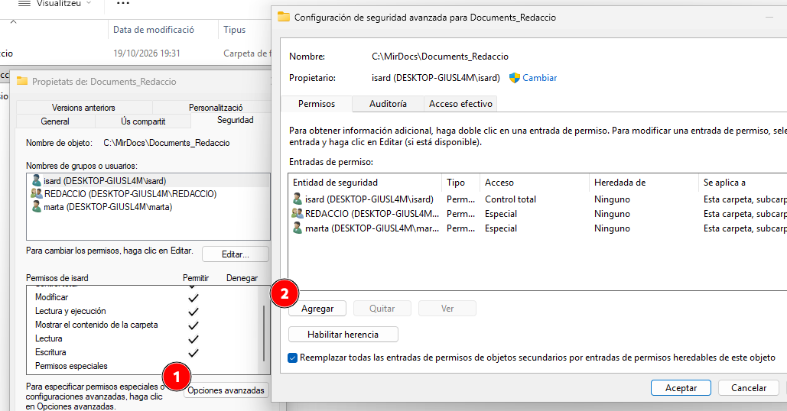
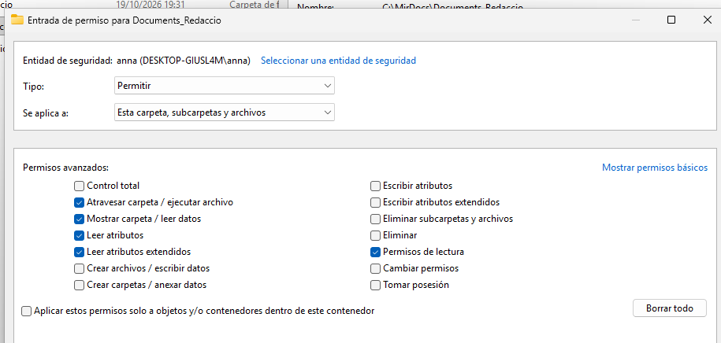
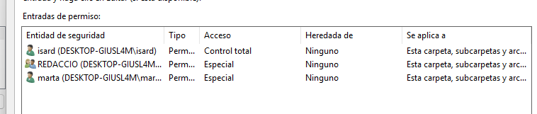

---

## marp: true theme: default paginate: true
marp: true
theme: custom
paginate: true
backgroundColor: white

# 🪟 Permisos i sistemes de fitxers a Windows
---

# Permisos i ACL a Windows

---
## :lock: Tipus de permisos a Windows

- **Permisos bàsics:**

  - Llegir (Read) - Veure el contingut d'un fitxer (incloent atributs i permisos)
  - Escriure (Write) - Escriure el contingut d'un fitxer i canviar atributs i metadades.
  - Llegir i executar (Read & Execute)
  - Modificar (Modify) - Escriure i esborrar un fitxer. No pots canviar permisos ni canviar propietari.
  - Control total (Full Control)
---

## :lock: Com accedir als permisos bàsics

`Botó dret sobre el recurs → Propietats → Seguretat`

---
## :lock: Tipus de permisos a Windows
- **Permisos especials:**

  Exemples:
  - Només té permís “Delete”.
  - Només “Take ownership”.
  - Una combinació parcial de Read i Write.

  **combinació personalitzada** de permisos avançats
  No coincideix exactament amb cap conjunt de permisos bàsics.

  

---

## :lock: Tipus de permisos a Windows
- **Permisos especials:**

- Apareixen quan un fitxer o carpeta té una **combinació personalitzada** de permisos avançats.
- No coincideix exactament amb cap conjunt de permisos bàsics.
- Exemples:
  - Només té permís “Delete”.
  - Només “Take ownership”.
  - Una combinació parcial de Read i Write.

➡️ Es poden veure a:
``Propietats → Seguretat → Opcions avançades → Mostra permisos avançats``

---

## :top: Permisos avançats (ACL)

- A nivell intern, Windows desglossa els permisos bàsics en permisos avançats (o detallats).

- Aquests permeten un control molt més precís sobre què pot fer l’usuari.

---

## :top: Com accedir a Permisos avançats (ACL)

---

## :top: Com accedir a Permisos avançats (ACL)

s---

## :top: Permisos avançats

<!-- _class: taula_gran -->

| Permís avançat | Descripció |
|-----------------|-------------|
| Traverse folder / Execute file | Entrar en subcarpetes o executar fitxers. |
| List folder / Read data | Veure contingut d’una carpeta o llegir dades d’un fitxer. |
| Read attributes | Veure atributs bàsics (mida, data, etc.). |
| Read extended attributes | Veure atributs definits per aplicacions. |
| Create files / Write data | Escriure o crear fitxers dins una carpeta. |
| Create folders / Append data | Afegir dades o crear subcarpetes. |

---

## :top: Permisos avançats (Part 2)

<!-- _class: taula_gran -->

| Permís avançat | Descripció |
|-----------------|-------------|
| Write attributes | Canviar atributs bàsics. |
| Write extended attributes | Canviar atributs definits per aplicacions. |
| Delete subfolders and files | Esborrar contingut dins una carpeta. |
| Delete | Esborrar el fitxer o carpeta. |
| Read permissions | Llegir ACLs. |
| Change permissions | Modificar ACLs. |
| Take ownership | Assumir la propietat. |

---

## 🧩 Relació entre permisos bàsics i avançats

| Permís bàsic | Equival a (avançats) |
|---------------|----------------------|
| **Read** | Read data, Read attributes, Read permissions |
| **Write** | Write data, Append data, Write attributes, Write extended attributes |
| **Read & Execute** | Read + Execute |
| **Modify** | Read + Write + Delete |
| **Full control** | Tots els permisos avançats |

---
## :arrow_heading_down: Herència i aplicació

- Els permisos **s'hereten** d'una carpeta pare.
- Podem desactivar l'herència que rep un objecte de l'objecte pare.
- Un fitxer o carpeta pot tenir **permisos propis** o **heretats**.
- Els permisos **"Deny"** tenen **prioritat** sobre els **"Allow"**.
- Un usuari rep la **suma** dels permisos:
  - Els seus propis
  - Més els dels grups als quals pertany
- En una carpeta podem obligar que els objectes continguts en ella només tinguin els permisos heredats com a permisos efectius.

---

## :blue_book: Access Control List (ACL)

- Cada recurs té una **ACL (Access Control List)**

- Cada entrada de la llista és una **ACE (Access Control Entry)** que especifica:

  - L’usuari o grup
  - Els permisos atorgats o denegats
  - El tipus (Allow / Deny)

- Els permisos poden ser:

  - Heretats d’un objecte pare
  - Definits explícitament sobre el recurs

---

## :blue_book: Com es veuen les ACL a Windows (ACL)

---

## 📁 Permisos sobre carpetes

| Permís bàsic | Descripció sobre carpetes |
|---------------|---------------------------|
| **Full control** | Totes les accions possibles. |
| **Modify** | Llegir, escriure, crear, eliminar. |
| **Read & execute** | Veure contingut i executar fitxers. |
| **List folder contents** | Veure noms de fitxers i subcarpetes. |
| **Read** | Veure el contingut. |
| **Write** | Crear fitxers i carpetes noves. |

➡️ Els permisos es poden aplicar a la carpeta, a les subcarpetes, als fitxers que hi han a dins o a tots tres.

---

## :floppy_disk: Permisos segons sistema de fitxers

### NTFS

- ACLs completes
- Propietaris, herència, permisos especials
- Suporta EFS, compressió i quotes

### ReFS

- Manté ACLs de NTFS
- Sense EFS ni compressió
- Millor integritat i recuperació d’errors

### exFAT / FAT32

- Només atributs simples: R, H, S, A
- Cap control per usuari

